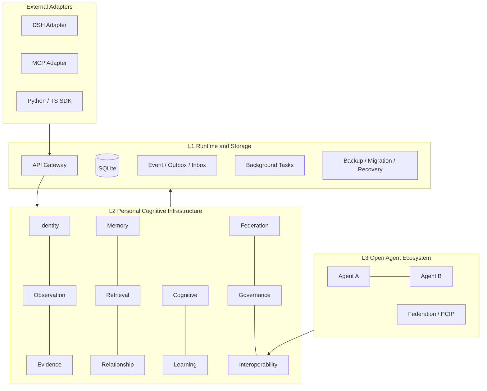

# Mnemosyne 2.0 最终实施方案

> 基线：`feat/mnemosyne-2.0-p0-p1` · PR [#13](https://github.com/DSH-Raising-Plan/dsh-mnemosyne/pull/13) · `9295d03`  
> 状态标注约定：`Implemented` / `Partial` / `Planned`（见各文档页眉）。  
> **路线已冻结：** [#17](https://github.com/DSH-Raising-Plan/dsh-mnemosyne/pull/17) Accepted → [#18](https://github.com/DSH-Raising-Plan/dsh-mnemosyne/pull/18) Merged → **P3 Foundation 1.0 Stabilized** → **Production Security Assessment（Next）**。  
> 不自动开 P3.2。约束：[`ENGINEERING_CONSTRAINTS.md`](./ENGINEERING_CONSTRAINTS.md)；路线：[`ROADMAP_FROZEN.md`](./ROADMAP_FROZEN.md)。

## 一、结论

以 PR #13 为 MVP 基线：**不推翻、不整体重写**。

| 维度 | 现状 |
| --- | --- |
| 功能 MVP | 基本成立，可合并试跑 |
| 数据安全 | 未达安全升级标准 |
| 生产运行 | 未达长期稳定标准 |
| 开放生态 | 未达通用组件 / 跨节点标准 |

原则：**先保证记忆不丢、不误删、不串 → 再保证处理正确 → 再开放接入。**

```
阶段 0  MVP 基线（PR #13）
阶段 1  P0 Safety Hardening     ← 当前
阶段 2  P1 Cognitive Correctness
阶段 3  P2 Integration & Production
阶段 4  Universal Ecosystem
```

## 二、定位与架构

**Personal Cognitive Infrastructure（个人认知基础设施）**  
每人一个 Mnemosyne Node；DSH 是第一个 Adapter，不是核心。

逻辑层（非微服务拆分要求）：



当前运行形态：独立 Python Memory Service + Node DSH Host Adapter + SQLite + REST；**Tasks 为正式后台执行路径**；Event/Outbox 为可靠事件记录与投递（见阶段 2 §5.5）。

## 三、阶段 0 — MVP 基线

保留：`MemoryService`、REST/MCP 共用业务层、进程隔离 Host、Observation→Memory、SQLite+Outbox、自动捕获、ChangePlan/Schema Gate、CLI backup/restore。

审计快照（12 项）：完整 0 · 部分 7 · 缺失/桩 5 → **不等于 PR 不可用**，表示生产闭环未齐。

文档必须用 Implemented / Partial / Planned，禁止把 Planned 写成 Implemented。

## 四、阶段 1 — P0 Safety Hardening

分支：`feat/mnemosyne-2.0-p0-safety-hardening`

| ID | 项 | 验收要点 |
| --- | --- | --- |
| P0-01 | 进程锁 | 同 `data_dir` 第二实例必须失败；退出/崩溃后可再获取；异目录可并行 |
| P0-02 | 备份恢复 | Backup API + manifest/checksum；round-trip 含 obs/mem/evidence/relation/task |
| P0-03 | 迁移安全 | Preflight、升级前自动备份、integrity_check、失败可恢复 |
| P0-04 | 删除级联 | Observation 删除；Hard Forget 清 versions/relations/schema refs/FTS；任务不可复活 |

全部通过后标记 **`Safe Upgrade Candidate`**（版本建议 2.0.1）。

### 删除语义

- **Invalidate**：退出检索/认知，保留必要审计。
- **Hard Forget**：清除可重建内容的派生副本；审计仅保留操作元数据（时间/类型/结果/不透明 ID）。

## 五、阶段 2 — P1 Cognitive Correctness（验收后）

- 三生命周期：Observation / Episode / Memory（勿把所有阶段塞进 `MemoryStatus`）。
- Evidence 独立实体；晋升读反证与来源独立性；Decision Log。
- **方案 A**：Tasks = 业务执行；Event/Outbox = 记录与可靠交付。

## 六、阶段 3 — P2 Integration

正式 MCP SDK、真 DSH E2E、AI Installer Skill、组件级授权、多实例（分 data_dir，非库内多租户）。

## 七、阶段 4 — Universal Ecosystem

分支：`feat/mnemosyne-2.0-p3-ecosystem`（叠在 P2 之上）

| ID | 项 | 状态 | 说明 |
| --- | --- | --- | --- |
| P3-01 | Component Contract schema | Implemented | `schemas/component-contract/v1.json` + 注册校验 |
| P3-02 | UDM envelope | Implemented | `schemas/universal-data-model/v1.json` + 映射/校验 API |
| P3-03 | Events schema | Implemented | `schemas/events/v1.json` |
| P3-04 | PCIP proposal | Partial | 文档 + L0–L2 stub；**L3 默认拒绝**；入站仅 Observation |
| P3-05 | Discovery API | Implemented | `GET /api/v1/discovery` |
| P3-06 | Thin SDKs | Implemented | `packages/mnemosyne-sdk` / `mnemosyne-sdk-ts` |
| P3-07 | P2P / Relay | Planned | 非本阶段交付 |

外部内容永不自动升为 Active Memory；InterestSignal 晋升与完整联邦仍为 Planned。

### Foundation 验收（#17）

结论：**Foundation Accepted** — 剩余 Partial/Planned **不阻塞** 本阶段合并，但列为后续生产化/联邦门槛。  
详见 [`P3_FOUNDATION_ACCEPTANCE.md`](./P3_FOUNDATION_ACCEPTANCE.md)。

| 能力 | 状态 |
| --- | --- |
| Universal Data Model 基础 Schema | Foundation Verified |
| Component Contract 基础校验 | Foundation Verified |
| 外部 REST 注册与 Discovery | Foundation Verified |
| PCIP L1/L3 基础安全边界 | Foundation Verified |
| L3 默认拒绝、Observation 隔离 | Foundation Verified |
| 完整 Schema 语义校验 | Partial（生产化门槛） |
| 生产级组件身份与授权 | Partial（生产化门槛） |
| 数据使用策略深层执法 | Planned（生产化门槛） |
| P2P / Relay Federation | Planned（联邦门槛） |

里程碑：已有不依赖 Mnemosyne 内部实现的外部组件，真实走通注册 → 发现 → 授权 → 交换 → 安全拒绝。

### P3.1 Foundation Stabilization

独立小阶段：冻结验收范围、可重复验证、发布基线。  
计划：[`P3.1_FOUNDATION_STABILIZATION.md`](./P3.1_FOUNDATION_STABILIZATION.md)  
基线 ID：`foundation-0.1.0`（`schemas/VERSIONS.json`）  
**不新增生态能力**；Partial/Planned 生产安全决策放在稳定基线发布之后。

**发布：** `P3 Foundation 1.0 — Stabilized`（#18）。 路线：`#17 Accepted → #18 Stabilization → Foundation 1.0 → Production Security Assessment`。 不自动进入 P3.2。

## 八、版本与执行顺序

| 版本 | 目标 |
| --- | --- |
| 2.0.0 | MVP（PR #13） |
| 2.0.1 | Safety Hardening |
| 2.1.0 | Cognitive Correctness |
| 2.2.0 | Production Integration |
| 3.0.0 | Universal Ecosystem |

**底线：** 不依赖 DSH 才能跑；每用户自有 Node；外部不直写库；注册≠授权；删除覆盖派生；跨用户分享默认关；先模块化单体。
