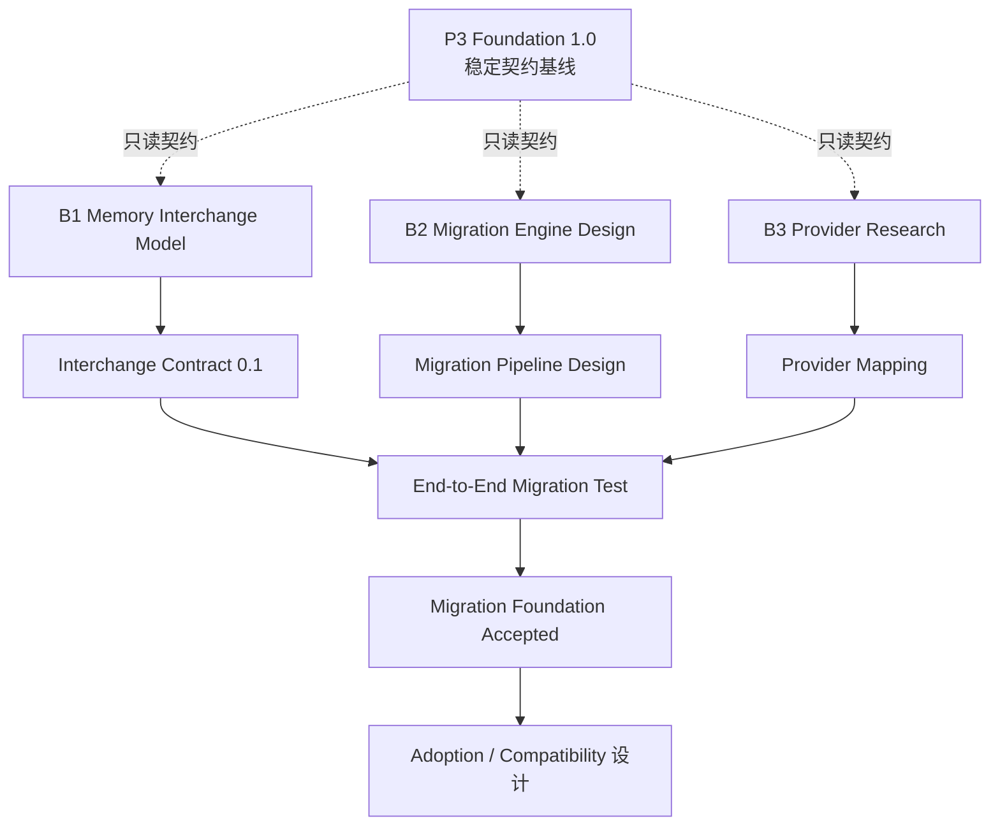

# Memory Migration & Adoption — 双轨并行方案

> **状态：** Design Track **Accepted**（Migration Foundation 设计退出条件已满足）  
> **硬约束：** 不得直接改变 Foundation 1.0 的 REST / PCIP / Component Contract。扩展须经兼容评估与显式版本升级。  
> **工程约束：** [`../ENGINEERING_CONSTRAINTS.md`](../ENGINEERING_CONSTRAINTS.md)  
> **Foundation 基线：** `foundation-0.1.0`（P3 Foundation 1.0 Stabilized）  
> **MIM：** `memory-interchange/0.1`（设计冻结）

## 核心思想

**双轨并行、三条工作流、统一架构边界。**

- 不打断 P3 Foundation 1.0 的稳定维护。  
- 独立推进 Memory Migration & Adoption 的设计与验证。  
- 不共享开发生命周期；共享稳定契约与治理边界。

```
主轨 A：Foundation 稳定维护          并行轨 B：Migration & Adoption
─────────────────────────          ─────────────────────────────
契约兼容 / CI / 安全不退化           B1 架构设计 ✓
Bug 修复 / 不主动扩生态              B2 迁移基础设计 ✓
                                    B3 Provider 映射验证 ✓
                                    B4 Adoption 设计 ✓
              └── 统一治理：Service Contract · Observation/Evidence · Provenance · Audit ──┘
```

| 轨 | 职责 | 规则 |
| --- | --- | --- |
| **A** | 守住已稳定基础 | 只维护；安全边界不放宽 |
| **B** | 设计并验证下一项核心能力 | 不得改 A 的稳定契约；独立验收后才申请进入主开发 |

---

## 统一治理边界

| 边界 | 含义 |
| --- | --- |
| Service Contract | 仅通过已发布的服务契约写入；不直写核心库表 |
| Observation / Evidence | 外源默认 Observation；不自动 Active Memory |
| Provenance | 保留原始来源与映射痕迹 |
| Audit | 批次可追踪、可恢复 |

三条安全原则对 B 轨同样生效。

---

## 三条工作流（轨 B）— 设计完成摘要

### Workstream 1 — 数据标准 ✓

文档：[`../architecture/MEMORY_INTERCHANGE_MODEL.md`](../architecture/MEMORY_INTERCHANGE_MODEL.md)  
Schema：`schemas/memory-interchange/v0.1.json`

三分模型未混用：Component Contract / MIM / Cognitive Model。

### Workstream 2 — 安全迁移引擎（设计）✓

文档：[`../architecture/MEMORY_MIGRATION_ARCHITECTURE.md`](../architecture/MEMORY_MIGRATION_ARCHITECTURE.md)

生命周期：Discover → Extract → Map → Preview → Plan → Staging → Validate → Commit | Rollback。  
**引擎代码未实现**（属未来 `2.1` 申请项）。

### Workstream 3 — Provider 验证 ✓

文档：[`../providers/PROVIDER_MATRIX.md`](../providers/PROVIDER_MATRIX.md)  
样例：`samples/providers/{json,markdown,sqlite,mem0}/`  
校验：`python scripts/validate_mim_samples.py`

---

## 依赖关系



> 注：当前 **Accepted** 指设计退出（含映射验证）。图中 E2E **实现**仍属 `2.1`；设计层已覆盖 Preview→Commit/Rollback。

---

## Git 分支

| 分支 | 用途 |
| --- | --- |
| `feat/mnemosyne-2.0-p3-ecosystem` | 主轨 A + 设计验收归档 |
| `design/memory-interchange` | Interchange 演进 |
| `design/memory-migration` | 迁移架构演进 |
| `research/provider-adapters` | Provider 样例演进 |

未来实现（**尚未创建**）：`feat/mnemosyne-2.1-memory-migration` — 须另开申请。

---

## 里程碑

| 里程碑 | 内容 | 状态 |
| --- | --- | --- |
| **M-A** | Interchange Model `0.1` | **Accepted** |
| **M-B** | Migration Architecture | **Accepted**（设计） |
| **M-C** | Provider Validation（≥2 类型） | **Accepted**（4/4 首批已映射） |
| **M-D** | Migration E2E 实现 | **Designed / Impl Deferred** |
| **M-E** | Adoption Design | **Accepted**（设计） |

---

## 明确暂缓

| 暂缓能力 | 原因 |
| --- | --- |
| 双向同步 | 冲突与删除传播复杂 |
| 自动切换旧 Agent | 须先验证迁移可靠性 |
| 完整 Compatibility Gateway | 需明确目标 Provider API 语义 |
| Zep / Letta 全量 Adapter | 首批管线未进入实现 |
| 自动发现所有本地记忆库 | 文件扫描、权限、隐私 |
| P2P / Relay | 与迁移目标无直接关系 |
| 自动退役旧记忆库 | 高风险用户操作 |
| 迁移引擎生产代码 / `2.1` 分支 | 待显式申请进入实现轨 |

数据源须由用户**明确指定** Provider 与位置。

---

## Design Track 退出条件（Migration Foundation Accepted）

- [x] Memory Interchange Model 有明确 Schema（`0.1`）  
- [x] Migration Engine 有完整生命周期设计  
- [x] 至少两个不同类型外部数据源完成映射验证（JSON/MD/SQLite/Mem0）  
- [x] 迁移具备预览、验证、幂等、回滚、来源追踪的设计  
- [x] **不破坏** Foundation 1.0  
- [x] **未提前实现**双向同步与完整兼容网关  

**结论：设计轨退出条件已满足。** 进入 `2.1` 实现轨仍需单独决策，不自动开启。

---

## 执行策略（一句话）

**主轨不动，设计并行，数据先行，迁移其次，接管最后。**
