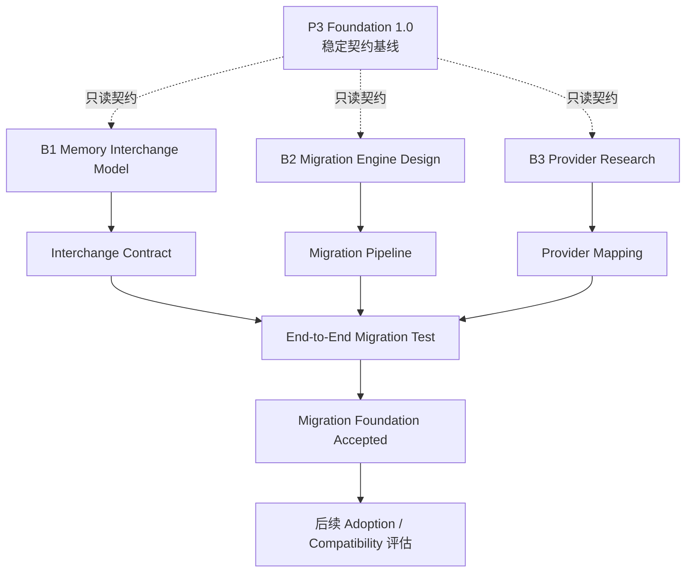

# Memory Migration & Adoption — 双轨并行方案

> **状态：** Design Track 启动（文档 / Schema 草案 / 验证样例）  
> **硬约束：** 不得直接改变 Foundation 1.0 的 REST / PCIP / Component Contract。扩展须经兼容评估与显式版本升级。  
> **工程约束：** [`../ENGINEERING_CONSTRAINTS.md`](../ENGINEERING_CONSTRAINTS.md)  
> **Foundation 基线：** `foundation-0.1.0`（P3 Foundation 1.0 Stabilized）

## 核心思想

**双轨并行、三条工作流、统一架构边界。**

- 不打断 P3 Foundation 1.0 的稳定维护。  
- 独立推进 Memory Migration & Adoption 的设计与验证。  
- 不共享开发生命周期；共享稳定契约与治理边界。

```
主轨 A：Foundation 稳定维护          并行轨 B：Migration & Adoption
─────────────────────────          ─────────────────────────────
契约兼容 / CI / 安全不退化           B1 架构设计
Bug 修复 / 不主动扩生态              B2 迁移基础（Preview→Staging）
                                    B3 Provider 验证
                                    B4 Adoption 设计
              └── 统一治理：Service Contract · Observation/Evidence · Provenance · Audit ──┘
```

| 轨 | 职责 | 规则 |
| --- | --- | --- |
| **A** | 守住已稳定基础 | 只维护；安全边界不放宽 |
| **B** | 设计并验证下一项核心能力 | 不得改 A 的稳定契约；独立验收后才申请进入主开发 |

---

## 统一治理边界

无论哪条轨，外部记忆进入 Mnemosyne 时必须遵守：

| 边界 | 含义 |
| --- | --- |
| Service Contract | 仅通过已发布的服务契约写入；不直写核心库表 |
| Observation / Evidence | 外源默认 Observation；不自动 Active Memory |
| Provenance | 保留原始来源与映射痕迹 |
| Audit | 批次可追踪、可恢复 |

三条安全原则（部署不默认放宽；字段≠执法；通信≠可信）对 B 轨同样生效。

---

## 三条工作流（轨 B）

### Workstream 1 — 数据标准与迁移架构（优先启动）

**目标：** 不同记忆系统可被 Mnemosyne **正确理解**。

| 工作项 | 交付物 |
| --- | --- |
| Canonical Memory Model | 统一记忆交换模型 |
| Provider Contract | Provider 接入规范 |
| Provenance Model | 来源与可信度表达 |
| Identity Mapping | 外部 ID ↔ 内部 ID |
| Relation Mapping | 关系 / 图结构映射 |
| Versioning | Schema 版本与兼容策略 |
| Import / Export Contract | 双向数据交换契约 |

**禁止：** 把 P3 Universal Data Model 扩成包罗万象的单一 Memory Schema。

**三分模型（相关但不可混）：**

| 模型 | 职责 | 文档 |
| --- | --- | --- |
| Component Contract | 组件如何接入 | Foundation `schemas/component-contract/` |
| Memory Interchange Model | 记忆如何交换 | [`../architecture/MEMORY_INTERCHANGE_MODEL.md`](../architecture/MEMORY_INTERCHANGE_MODEL.md) |
| Mnemosyne Cognitive Model | Mnemosyne 如何理解与管理 | 沿用现有认知记忆语义；不在本轨重写 |

**交付目标：** 与具体 Provider 无关的 **Memory Interchange Specification**。

### Workstream 2 — 安全迁移引擎（并行设计）

**目标：** 迁移可预览、可验证、可恢复。

建议模块边界：

```
migration/
├── providers/      # registry + adapters
├── extraction/     # source_reader
├── interchange/    # schema + mapper
├── planning/       # preview · planner · conflict_detector
├── execution/      # staging · batch_manager · executor
├── validation/     # integrity · reconciliation
└── recovery/       # rollback · resume
```

**第一阶段只支持：** 发现数据源 → 读取 → 预览 → 计划 → Staging → 完整性校验 → 提交或回滚。

**暂不做：** 自动切换 Agent、双向同步。

**必须保证：**

- 不直接写核心数据库  
- 不覆盖已有记忆  
- 不自动将外部内容晋升为 Active Memory  
- 不丢失原始来源  
- 批次可追踪、可恢复  
- 失败不破坏原系统  

**交付目标：** 不依赖具体 Provider 的完整迁移管线设计（及后续实现）。

### Workstream 3 — Provider 与真实场景验证（并行）

**首批验证对象：**

| 对象 | 验证目标 |
| --- | --- |
| JSON / JSONL | 通用交换格式 |
| Markdown | 非结构化个人记忆 |
| SQLite | 本地结构化记忆 |
| Mem0 | 外部 Memory API |

第二批再考虑 Zep / Graphiti、Letta。

**统一数据流：**

```
Provider → Provider Adapter → Memory Interchange Model
        → Migration Engine → Mnemosyne Service Contract
        → Observation / Evidence
```

**交付目标：** 至少 **两种不同类型** 数据源经相同管线成功映射/导入验证。

**注意：** Provider **研究**可立即开始；Adapter **正式实现**须等 Interchange Contract 稳定，避免各 Provider 私自发明字段后再重构。

---

## 依赖关系



---

## Git 分支安排

| 分支 | 用途 |
| --- | --- |
| `feat/mnemosyne-2.0-p3-ecosystem` | 主轨 A：P3 稳定基线维护 |
| `design/memory-interchange` | 数据交换模型设计 |
| `design/memory-migration` | 迁移架构设计 |
| `research/provider-adapters` | Provider 调研与样本验证 |

设计阶段优先提交：**文档、Schema 草案、测试样例、架构图**。

未来实现阶段（**现在不创建**）建议命名：`feat/mnemosyne-2.1-memory-migration`。

---

## 里程碑（按验收，不按模块数量）

| 里程碑 | 内容 | 验收结果 | 并行 |
| --- | --- | --- | --- |
| **M-A** | Interchange Model | Schema + 版本契约确定 | 可与 M-B/M-C 并行 |
| **M-B** | Migration Architecture | 模块边界、生命周期、回滚策略确定 | 可与 M-A/M-C 并行 |
| **M-C** | Provider Validation | 两种不同来源成功映射 | 可与 M-A/M-B 并行 |
| **M-D** | Migration E2E | Preview → Plan → Staging → Verify → Commit | 需 M-A/B/C 接口稳定 |
| **M-E** | Adoption Design | Bridge、权威来源、切换策略确定 | 可同步设计；实现不挡 M-D |

---

## 明确暂缓（防范围膨胀）

| 暂缓能力 | 原因 |
| --- | --- |
| 双向同步 | 冲突与删除传播复杂 |
| 自动切换旧 Agent | 须先验证迁移可靠性 |
| 完整 Compatibility Gateway | 需明确目标 Provider API 语义 |
| Zep / Letta 全量 Adapter | 首批管线未稳 |
| 自动发现所有本地记忆库 | 文件扫描、权限、隐私 |
| P2P / Relay | 与迁移目标无直接关系 |
| 自动退役旧记忆库 | 高风险用户操作 |

数据源须由用户**明确指定** Provider 与位置；禁止未经授权全盘扫描。

---

## Design Track 退出条件（Migration Foundation Accepted）

- [ ] Memory Interchange Model 有明确 Schema  
- [ ] Migration Engine 有完整生命周期设计  
- [ ] 至少两个不同类型外部数据源完成映射验证  
- [ ] 迁移具备预览、验证、幂等、回滚、来源追踪的设计  
- [ ] **不破坏** Foundation 1.0  
- [ ] **未提前实现**双向同步与完整兼容网关  

通过后，才申请进入主开发路线（未来 `2.1` 实现轨）。

---

## 执行策略（一句话）

**主轨不动，设计并行，数据先行，迁移其次，接管最后。**

让用户带着已有记忆进入 Mnemosyne，而不是为了用 Mnemosyne 从零开始。
